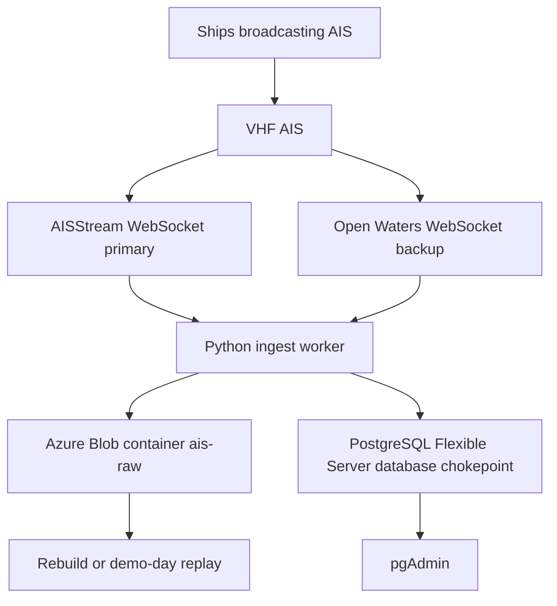
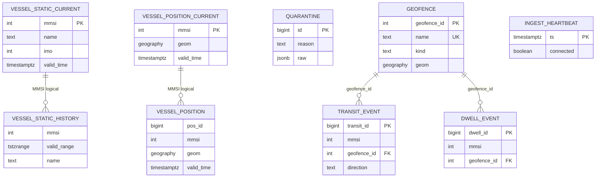
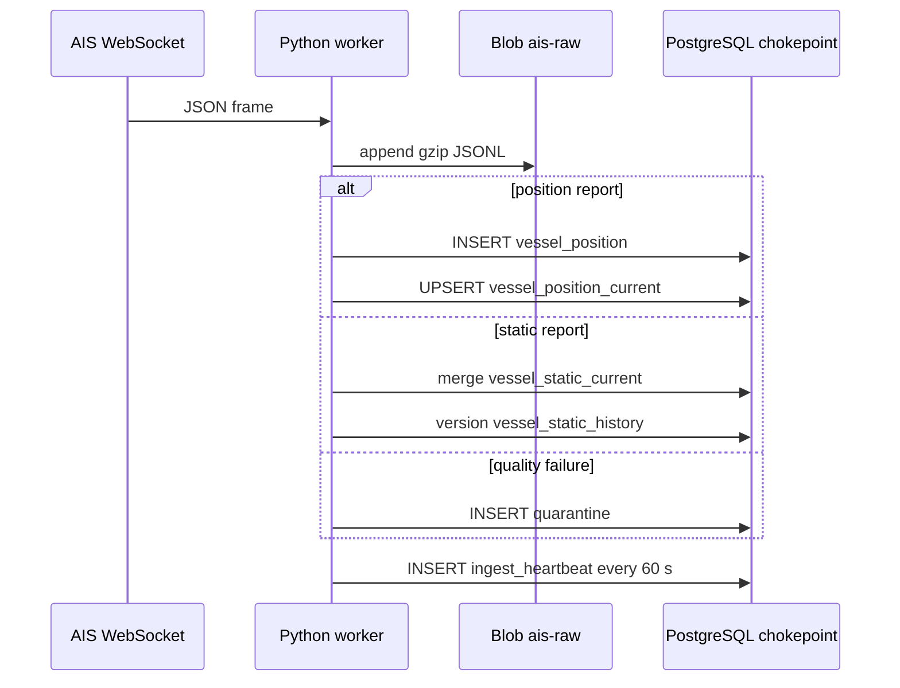

# Database administrator manual

Singapore Strait vessel-traffic database (`chokepoint`)

| Field | Value |
| --- | --- |
| Document type | Operations and diagnosis manual |
| Audience | Student database administrators, teammates who run ingest, examiners who must see how the live system is organised |
| System of record | Azure Database for PostgreSQL Flexible Server, database `chokepoint` |
| Spatial engine | PostGIS 3.6 on PostgreSQL 16 |
| Companion SQL | `sql/diagnostics/catalog.sql`, `sql/diagnostics/one_ship.sql` |
| Secrets | None in this file. Passwords, storage keys, and Automatic Identification System (AIS) tokens stay in a local `.env` that is never committed |

Related runbooks: [azure-setup.md](azure-setup.md), [ingest.md](ingest.md), [geofences.md](geofences.md). Evidence queries: [sql/queries/](../sql/queries/). Schema source of truth: [sql/schema/001_core.sql](../sql/schema/001_core.sql).

This manual answers four operational questions in full:

1. What attributes does the system collect, and what does it refuse to store?
2. How are those attributes organised (servers, databases, schemas, tables, partitions, indexes)?
3. How many databases, tables, and attributes exist, and how fast do rows arrive?
4. Which SQL does an administrator run to diagnose health, inventory, lag, quality, and a single ship?

Numbers in section 8 are a measured baseline from the first successful laptop capture on 16 October 2026. Recompute them with the diagnostic file whenever ingest has run again. Do not treat the baseline as a service-level objective.

---

## Contents

1. Purpose of the database
2. System architecture
3. Geographic collection box
4. Inventory: servers, databases, schemas
5. Logical data model
6. Tables and attributes
7. What is collected, and what is not
8. Observed collection rates
9. Temporal and spatial rules a DBA must not break
10. Write path from a radio frame to a row
11. How to connect and where to run SQL
12. Diagnostic SQL (D1 to D32)
13. Inspecting one ship
14. Failure notes
15. Privileges
16. Backup, partitions, and retention
17. Daily operator checklist
18. Related files

---

## 1. Purpose of the database

The database is the system of record for a live picture of ships in the Singapore Strait. Ships broadcast AIS messages over very high frequency (VHF) radio. A public WebSocket feed (AISStream as primary, Open Waters as backup) delivers decoded JSON to a Python worker. The worker writes every raw frame to Azure Blob Storage and writes validated facts to Azure Database for PostgreSQL Flexible Server with the PostGIS spatial extension.

Administrators and analysts use pgAdmin. There is no product user interface. Course marks and day-to-day operations rest on three Advanced Database Management Systems (ADBMS) features:

- Temporal facts: when a position was true in the world (`valid_time`) and when this database learned it (`ingest_time`).
- Spatial facts: points and polygons on the World Geodetic System 1984 (WGS 84) ellipsoid, stored as PostGIS `geography`.
- Moving objects: a current row per ship plus an append-only history that can be reconstructed as a trajectory.

The database does not forecast, score collisions, or store cargo. It answers who is in a traffic lane, who sat in an anchorage, where a named ship went between two times, what the picture looked like at time T, and whose position has gone stale.

Three student administrators share responsibility. One person may run ingest while another runs diagnostics in pgAdmin. Both must use the same database (`chokepoint`) and must never load schema into the server default database (`postgres`).

---

## 2. System architecture

There is one cloud data plane: Microsoft Azure. Amazon Web Services is not used. AIS providers are not Azure resources. Their keys never go in the Azure portal.

```text
  Ships
    |  VHF AIS
    v
  AISStream  (primary WebSocket)     Open Waters (backup WebSocket)
    |                                         |
    +------------------+----------------------+
                       |
                       v
              Python ingest worker
              (laptop now; Linux VM later)
                       |
          +------------+-------------+
          |                          |
          v                          v
   Azure Blob Storage         Azure Database for PostgreSQL
   account + container         Flexible Server aiscpdbgg013
   ais-raw                     database: chokepoint
   raw/ais/yyyy/mm/dd/         schemas: ais, ops
        hh.jsonl.gz            PostGIS 3.6
          |                          |
          |                          v
          |                    pgAdmin on the DBA laptop
          |
          +-- demo-day replay / rebuild
```



How to read the diagram:

1. The radio is outside our control. We subscribe to a geographic box around the Singapore Strait. Corners are sent to AISStream as `[latitude, longitude]` pairs.
2. The worker authenticates to the WebSocket, requests message types `PositionReport`, `StandardClassBPositionReport`, `ExtendedClassBPositionReport`, `ShipStaticData`, and `StaticDataReport`, and listens.
3. Every frame, including `SubscriptionConfirmation`, is appended to an hourly gzip JSON Lines blob. That is the landing zone. If PostgreSQL is rebuilt, those files can be replayed.
4. Frames that parse and pass quality rules become rows in PostgreSQL. Frames that fail (missing Maritime Mobile Service Identity (MMSI), bad coordinates, impossible speed, time too far in the future) go to `ais.quarantine`.
5. pgAdmin is the only interactive surface. Queries in `sql/queries/` are the evidence pack.

SSL is required on PostgreSQL (`sslmode=require`). Port 5432 is not a website. The fully qualified domain name `aiscpdbgg013.postgres.database.azure.com` does not load in a browser. The Flexible Server firewall must list the current public IP of the DBA laptop and, later, the ingest virtual machine.

The worker sets `application_name` to `adbms-ingest`. Event refresh sets `adbms-events`. Diagnostic D22 lists those names so an administrator can see who is connected.

---

## 3. Geographic collection box

The live subscribe box is a rectangle in decimal degrees. Southwest corner is latitude 1.10, longitude 103.40. Northeast corner is latitude 1.48, longitude 104.15. That covers the Singapore Strait traffic-separation scheme and adjacent port waters. A Gibraltar box exists in code as a backup and is not used unless an administrator passes `--box gibraltar`.

```text
  latitude
      1.48 N --------------------------------  104.15 E
             |                                |
             |   Singapore Strait live box    |
             |   AISStream / Open Waters      |
             |   subscribe rectangle          |
             |                                |
      1.10 N --------------------------------
           103.40 E

  PostGIS stores points as geography(Point, 4326).
  ST_MakePoint takes longitude first, then latitude.
  A point at 1.2619 N, 103.8455 E is stored as (103.8455, 1.2619).
```

Operational polygons inside that box live in `ops.geofence`. They are student sketches for containment queries, not navigational charts. Lane vertices follow published WGS 84 traffic-separation coordinates in Maritime and Port Authority of Singapore, Singapore Port Information 2026, Annex 5 to 7 (International Maritime Organization COLREG.2 circulars cited in that booklet). Western Anchorage is a box around the published AWW representative point. The port-limit polygon is a simplified southern-waters sketch.

Stored positions from a healthy capture should fall inside the subscribe rectangle. Diagnostic D28 reports the bounding box of `ais.vessel_position`. If min/max latitude or longitude sit far outside 1.10 to 1.48 N and 103.40 to 104.15 E, the worker subscribed to the wrong box or `ST_MakePoint` argument order was reversed.

---

## 4. Inventory: servers, databases, schemas

### 4.1 How many databases

| Item | Count | Identity |
| --- | --- | --- |
| Azure PostgreSQL Flexible Server | 1 | `aiscpdbgg013` in resource group `rg-ais-chokepoint`, Central India |
| Project database (system of record) | 1 | `chokepoint` |
| Server default database | 1 | `postgres` (maintenance, no AIS tables) |
| Blob container (not a database) | 1 | `ais-raw` |

A Flexible Server always has a `postgres` database. Administrators connect to `postgres` only to create `chokepoint` or to run server-wide checks. All AIS tables live in `chokepoint`. Do not load `001_core.sql` into `postgres`. Extensions are per-database: PostGIS on `postgres` does not help `chokepoint`.

SKU in use: Burstable Standard_B1ms, 32 GiB storage, high availability off, PostgreSQL 16, public access with IP firewall. Backup retention is 7 days. Geo-redundant backup is off.

Confirm while connected to `chokepoint` (diagnostic D1 and D2):

```sql
SELECT current_database();
SELECT datname FROM pg_database WHERE datistemplate = false ORDER BY 1;
```

Expected: `current_database()` is `chokepoint`. `pg_database` lists at least `postgres` and `chokepoint`. Azure may also show internal names. Those are not application databases.

### 4.2 Schemas

Inside `chokepoint` the application owns two schemas.

| Schema | Role |
| --- | --- |
| `ais` | Facts from the radio: positions, static identity, quarantine |
| `ops` | Operator objects: geofences, transits, dwells, ingest heartbeat |

`public` exists by default. Application objects must not be created there. PostGIS may add `topology` and, on some installs, `tiger`. Those belong to the extension.

```text
database chokepoint
|-- schema ais          facts
|   |-- vessel_position                 history, partitioned by valid_time
|   |-- vessel_position_YYYYMMDD        daily children of the parent
|   |-- vessel_position_current         one row per MMSI
|   |-- vessel_static_current           one row per MMSI
|   |-- vessel_static_history           versioned identity, tstzrange
|   +-- quarantine                      rejected frames
|-- schema ops          operator
|   |-- geofence
|   |-- transit_event
|   |-- dwell_event
|   +-- ingest_heartbeat
|-- extension PostGIS   spatial types and functions
+-- function ais.ensure_position_partitions(date, date)
```

---

## 5. Logical data model

Physical tables do not all have foreign keys. AIS is an unordered stream: a Class A position can arrive before the type 5 static identity for that MMSI, and some Class B ships never send a usable name. The model therefore keys facts by MMSI and joins in queries with `LEFT JOIN`. The only enforced foreign keys are from derived events back to `ops.geofence`.

```text
  ais.vessel_static_current          ais.vessel_position_current
  (1 row per MMSI)                   (1 row per MMSI)
           ^                                  ^
           | same MMSI, no FK                 | same MMSI, no FK
           |                                  |
  ais.vessel_static_history          ais.vessel_position
  (versions, tstzrange)              (append-only, partitioned)

  ais.quarantine                     ops.ingest_heartbeat
  (rejected frames)                  (one row per minute of ingest)

  ops.geofence  (4 polygons)
       |
       |  FOREIGN KEY geofence_id
       +-- ops.transit_event
       +-- ops.dwell_event
```



Partitioning is physical, not a separate entity. `ais.vessel_position` is `PARTITION BY RANGE (valid_time)`. Each child is named `ais.vessel_position_YYYYMMDD` and holds one UTC calendar day. Queries against the parent still look like one table. `EXPLAIN` on a day filter should touch one child (evidence query Q9).

---

## 6. Tables and attributes

### 6.1 How many tables and how many attributes

There are **nine designed tables**. One of them, `ais.vessel_position`, is partitioned by range on `valid_time`. The loader function `ais.ensure_position_partitions` creates one child table per UTC calendar day for yesterday through seven days ahead (nine children in a typical hot window). Child tables are physical pieces of the parent, not extra designs.

When you count `information_schema.tables` for schemas `ais` and `ops`, you will see the nine names plus every `vessel_position_YYYYMMDD` child. That is expected. Diagnostic D4 lists children. Diagnostic D6 counts columns on the nine designed names only.

| Designed table | Columns | Kind of growth |
| --- | --- | --- |
| `ais.vessel_position` | 12 | Insert only (append-only history) |
| `ais.vessel_position_current` | 10 | Upsert; one row per MMSI |
| `ais.vessel_static_current` | 14 | Upsert; one row per MMSI |
| `ais.vessel_static_history` | 14 | Insert when identity changes |
| `ais.quarantine` | 5 | Insert when a frame is rejected |
| `ops.geofence` | 6 | Static; four operational polygons |
| `ops.transit_event` | 10 | Batch, from `uv run adbms-events` |
| `ops.dwell_event` | 7 | Batch, from `uv run adbms-events` |
| `ops.ingest_heartbeat` | 7 | One insert per minute while ingest runs |

**Column instances across the nine designed tables: 85.** Several names repeat (`mmsi`, `valid_time`, `source`). That is intentional: current and history are separate relations. Confirm with D6. If D6 disagrees with this table, the live database has drifted from `001_core.sql`.

There is no foreign key from positions to static identity. A ship can have history points and a null name until a static message arrives.

### 6.2 Position facts (`ais.vessel_position` and `ais.vessel_position_current`)

These come from AIS position reports (ITU-R M.1371 types 1, 2, 3 and Class B types 18 and 19), delivered as JSON `PositionReport`, `StandardClassBPositionReport`, or `ExtendedClassBPositionReport`.

| Column | Type | Meaning |
| --- | --- | --- |
| `pos_id` | bigint identity | Surrogate key on history only. Combined with `valid_time` as the partition-safe primary key. |
| `mmsi` | integer | Maritime Mobile Service Identity of the transmitting station. |
| `geom` | geography(Point, 4326) | WGS 84 point. PostGIS `ST_MakePoint` uses longitude then latitude. |
| `sog_kn` | double precision | Speed over ground in knots. AIS sentinel 102.3 is stored as null. Values above 80 knots are quarantined, not stored. |
| `cog_deg` | double precision | Course over ground in degrees. Sentinel 360 is stored as null. |
| `heading_deg` | integer | True heading. Sentinel 511 is stored as null. |
| `nav_status` | integer | AIS navigational status (under way, at anchor, and so on). |
| `msg_type` | text | Envelope `MessageType` string. |
| `valid_time` | timestamptz | When the position was true in the world (AIS event time, UTC). |
| `ingest_time` | timestamptz | When this database learned the fact. Default `clock_timestamp()`. |
| `source` | text | `aisstream` or `aiscast`. |
| `payload_sha256` | text | Hash of the raw frame. Unique together with `mmsi` and `valid_time` so exact duplicates are ignored. |

History is append-only. Current is one row per MMSI. The worker updates current only when the incoming `valid_time` is greater than or equal to the stored one. Out-of-order packets therefore cannot roll the live picture backwards. History insert and current upsert run in one PostgreSQL transaction. A current row whose MMSI has zero history rows is a loader bug.

`payload_sha256` exists only on history. The current table does not need it because there is only one live row per MMSI.

```text
ais.vessel_position  (parent, PARTITION BY RANGE valid_time)
   |
   +-- ais.vessel_position_20261016  UTC day 16 Oct 2026
   +-- ais.vessel_position_20261017  UTC day 17 Oct 2026
   +-- ... one child per UTC date in the hot window

ais.vessel_position_current
   one row per MMSI = the newest accepted position
```

Indexes the DBA should see (D8):

- On each daily child: GiST on `geom`, btree on `(mmsi, valid_time DESC)`.
- On current: GiST on `geom`, btree on `valid_time`.
- Unique on history: `(mmsi, valid_time, payload_sha256)`.
- Primary key on history: `(pos_id, valid_time)` because PostgreSQL requires the partition key in unique indexes on partitioned tables.

### 6.3 Static identity (`ais.vessel_static_current` and `ais.vessel_static_history`)

These come from AIS static and voyage data (type 5 and Class B static). Envelope types `ShipStaticData` and `StaticDataReport`.

| Column | Type | Meaning |
| --- | --- | --- |
| `mmsi` | integer | Same ship identifier as positions. Primary key on current. |
| `name` | text | Vessel name. AIS padding with `@` is stripped. |
| `ship_type` | integer | AIS ship and cargo type code. Zero is stored as null. |
| `callsign` | text | Radio call sign. |
| `imo` | integer | International Maritime Organization number. Zero is stored as null. |
| `dim_bow_m`, `dim_stern_m`, `dim_port_m`, `dim_starboard_m` | integer | Reported dimensions in metres from the GNSS antenna. |
| `destination` | text | Voyage destination text. |
| `eta` | text | Estimated time of arrival as `MM-DD HH:MM` when the AIS ETA fields are usable. |
| `valid_time` | timestamptz | On current: when this identity version became true. |
| `valid_range` | tstzrange | On history only: half-open interval `[start, end)`. A GiST exclusion constraint forbids overlapping ranges for the same MMSI. |
| `ingest_time` | timestamptz | When this database learned the version. |
| `source` | text | Feed name. |

Partial Class B static reports (name in part A, dimensions in part B) merge onto the current row. A new history version is written only when identity fields change. If a later packet has the same identity and a newer `valid_time`, current is touched and history is left alone. If identity would change at the same `valid_time`, the frame is quarantined as `static_same_time_change`. If a GiST exclusion fires, the frame is quarantined as `static_history_overlap`.

### 6.4 Quarantine (`ais.quarantine`)

| Column | Type | Meaning |
| --- | --- | --- |
| `id` | bigint identity | Surrogate key. |
| `received_at` | timestamptz | When the worker rejected the frame. |
| `reason` | text | Machine-readable cause. See the list below. |
| `source` | text | Feed name. |
| `raw` | jsonb | JSON of the envelope, or a short parse-error object. Never an API key. |

Reasons the worker can write:

- `missing_mmsi`
- `missing_coordinates`
- `bad_coordinates` (latitude 91, longitude 181, or the point 0, 0)
- `impossible_speed` (speed over ground above 80 knots)
- `missing_valid_time`
- `future_valid_time` (more than 120 seconds ahead of the worker clock)
- `valid_time_too_old` (more than 30 days behind)
- `parse_error`
- `no_partition` (insert failed after the worker tried to create the UTC day)
- `static_history_overlap`
- `static_same_time_change`
- `unknown_message_type`

AIS unavailable sentinels are **not** quarantine. Speed 102.3 knots, course 360 degrees, and heading 511 are stored as null on an otherwise valid position.

A capture can have zero quarantine rows. `GROUP BY reason` on an empty table returns zero rows. That is success, not a failed query.

### 6.5 Geofences (`ops.geofence`)

| Column | Type | Meaning |
| --- | --- | --- |
| `geofence_id` | integer identity | Primary key. Referenced by transit and dwell events. |
| `name` | text unique | Stable name used in SQL and in the course report. |
| `kind` | text | Check constraint: `lane_east`, `lane_west`, `anchorage`, `port_limit`. |
| `geom` | geography(Polygon, 4326) | Closed ring, longitude then latitude. |
| `drawn_by` | text | Who loaded the sketch (`adbms-group`). |
| `notes` | text | Source citation (MPA Singapore Port Information 2026 annexes). |

Four rows after `sql/schema/002_geofences.sql`:

| name | kind |
| --- | --- |
| `tss_eastbound` | `lane_east` |
| `tss_westbound` | `lane_west` |
| `western_anchorage` | `anchorage` |
| `singapore_port_limit_sketch` | `port_limit` |

`ST_IsValid(geom::geometry)` must be true on all four before anyone runs the query pack. Diagnostic D19 checks that.

### 6.6 Transit and dwell events

These tables stay empty until an administrator runs `uv run adbms-events`. That job reads recent positions (default lookback 48 hours), tests coverage against the lane and anchorage polygons, and replaces derived rows. It is a batch rebuild, not a stream.

Transit rule: two consecutive points inside a single lane opens a transit. Two consecutive points outside closes it. A span under two minutes is ignored. Direction is which lane polygon contained the ship, not course over ground. A point that sits in both east and west polygons counts as outside (overlap is treated as the separator).

Dwell rule: inside the anchorage polygon and speed over ground under 0.5 knots for fifteen minutes. The dwell ends when speed reaches 1.0 knot or the ship leaves the polygon.

| `ops.transit_event` column | Meaning |
| --- | --- |
| `transit_id` | Identity. |
| `mmsi` | Ship. |
| `geofence_id` | Lane polygon. Foreign key to `ops.geofence`. |
| `direction` | `east` or `west`. |
| `enter_time`, `leave_time` | Valid time of the opening and closing samples. `leave_time` is null while open. |
| `enter_geom`, `leave_geom` | Points at enter and leave. |
| `enter_ingest`, `leave_ingest` | Ingest time of those samples (knowledge time). |

| `ops.dwell_event` column | Meaning |
| --- | --- |
| `dwell_id` | Identity. |
| `mmsi` | Ship. |
| `geofence_id` | Anchorage polygon. Foreign key to `ops.geofence`. |
| `start_time`, `end_time` | Valid time span. `end_time` is null while open. |
| `min_sog`, `median_sog` | Speed over ground statistics while dwelling. |

A short laptop capture often produces zero dwells. A harbour tug sitting just east of the western anchorage box will not match. That is a geofence coverage fact, not a loader failure.

### 6.7 Ingest heartbeat (`ops.ingest_heartbeat`)

| Column | Type | Meaning |
| --- | --- | --- |
| `ts` | timestamptz PK | Worker clock at the heartbeat. Default `clock_timestamp()`. |
| `source` | text | Feed currently in use. |
| `connected` | boolean | WebSocket up. A final row with `false` is a clean shutdown. |
| `msg_last_minute` | integer | Application messages in the last sixty seconds. |
| `distinct_mmsi_last_minute` | integer | Distinct MMSI in that window. |
| `lag_p50_s`, `lag_p95_s` | double precision | Ingest lag percentiles for recent positions, seconds. |

The worker writes about one row per minute while running (`_HEARTBEAT_S = 60`). This is the first table to read when someone asks whether ingest is up (D17).

---

## 7. What is collected, and what is not

Collected from the live feed into PostgreSQL:

- Identity: MMSI, name, call sign, IMO number, ship type, dimensions.
- Motion: geographic point, speed over ground, course over ground, heading, navigational status.
- Voyage: destination and ETA when present.
- Provenance: message type, source feed, payload hash.
- Time: valid time and ingest time on every fact.

Not collected into PostgreSQL:

- Draught, rate of turn, position-accuracy flag, and other AIS fields the worker does not map.
- Cargo, crew, or commercial documents.
- Machine-learning features, predicted arrival, or collision scores.
- The AISStream or Open Waters API key (subscribe JSON is outbound only and is never landed).

Raw frames in blob still contain the full vendor JSON, so a later rebuild can extract extra fields if the schema grows. Until then PostgreSQL stores only the columns in section 6.

---

## 8. Observed collection rates

Rates depend on the feed and on whether the worker is running. The figures below are from the first successful laptop capture, 16 October 2026, 19:51:45 to 20:35:47 UTC (about 44 minutes, 2642 seconds of valid-time span). They are a baseline, not a service-level objective.

| Table | Stock after that capture | Rate while ingest ran | If the same pace ran 24 hours |
| --- | --- | --- | --- |
| `ais.vessel_position` | 360 rows | about 8.2 rows per minute (0.14 per second, 490 per hour) | about 12,000 per day |
| `ais.vessel_position_current` | 127 ships | about 8 upserts per minute; table size stays near the number of distinct ships in the box | still about 100 to 150 rows |
| `ais.vessel_static_current` | one row per ship that sent static data | a few upserts per minute | hundreds of ships, one row each |
| `ais.vessel_static_history` | a version when name or type changes | rare | slow |
| `ais.quarantine` | 0 | 0 on that capture | only rejected frames |
| `ops.geofence` | 4 after `002_geofences.sql` | none | 4 |
| `ops.ingest_heartbeat` | about one per minute of ingest | 1 row per minute | 1,440 per day if always on |
| `ops.transit_event`, `ops.dwell_event` | 0 until `adbms-events` | batch, not streamed | tens on a busy day after a refresh |
| Blob hourly object | one `hh.jsonl.gz` per UTC hour of ingest | every WebSocket frame | 24 objects per day if always on |

The day-1 spike (10 minutes, same box, report `reports/day1_spike.md`) measured 0.265 AIS application messages per second, 98 distinct MMSI, mostly `PositionReport`. Stored history on 16 October was slower than that (0.14 position rows per second) because static messages, duplicates, and Class B gaps do not all become new `vessel_position` rows. Ingest lag on that capture was about two seconds (median `ingest_time - valid_time`).

These rates drop to zero when the laptop worker stops. History remains. Current rows remain but grow stale. Heartbeat stops. Put the worker on Ubuntu with [ingest-vm.md](ingest-vm.md) so history continues overnight.

Worked example from that capture: MMSI 563009190, name `NOBLE JEWEL TG45`, a Singapore-flagged harbour tug (IMO 9386108). Fourteen history points between 19:54 and 20:32 UTC, all near 1.2619 N, 103.8455 E. That is a correctly loaded stationary track. A sitting tug reports often, so it can win "most points" without crossing the strait. Use `sql/diagnostics/one_ship.sql` to reprint that series.

Recompute the position rate at any time with D12. Recompute distinct ships and span with D11.

---

## 9. Temporal and spatial rules a DBA must not break

1. **Valid time is world time.** Queries about "who was where at T" filter `valid_time`, not `ingest_time`.
2. **Ingest time is knowledge time.** The as-of-ingest query (Q12) uses both: a late packet can be true at T and unknown until later.
3. **Partitions follow valid time.** A row with `valid_time` on 16 October 2026 UTC must land in `ais.vessel_position_20261016`. The worker calls `ais.ensure_position_partitions` at startup and creates a missing day if an insert reports no partition.
4. **Do not insert fake ships.** Evidence must come from the feed. Geofences are the only hand-loaded geometries.
5. **Geography, not geometry, for earth distance.** Points and polygons use `geography(Point, 4326)` and `geography(Polygon, 4326)`. `ST_MakePoint` and WKT polygons are longitude then latitude.
6. **Current is not history.** A trajectory needs two or more rows in `ais.vessel_position` for one MMSI. `vessel_position_current` cannot draw a path.
7. **Clock filters lie after an overnight gap.** A query that says `valid_time >= clock_timestamp() - interval '6 hours'` returns empty if ingest stopped last night even when hundreds of history rows exist. Evidence queries Q5, Q6, Q8, and Q12 are written against stored `max(valid_time)`, not against the wall clock, for that reason.

If `db_now` (D1 or D11) is many hours after `max(valid_time)`, ingest has been stopped. Current ships look stale. That is a lost-contact picture and is useful evidence (query Q7). It is not corruption.

---

## 10. Write path from a radio frame to a row

```text
WebSocket frame
    |
    +--> blob append (every frame, including confirmation)
    |
    v
classify_frame
    |
    +-- skip SubscriptionConfirmation
    +-- quarantine (quality failure)
    +-- PositionRecord
    |       |
    |       v
    |   BEGIN
    |     INSERT ais.vessel_position
    |       ON CONFLICT (mmsi, valid_time, payload_sha256) DO NOTHING
    |     UPSERT ais.vessel_position_current
    |       WHERE stored valid_time <= incoming valid_time
    |   COMMIT
    |
    +-- StaticRecord
            |
            v
        BEGIN
          merge Class B parts onto current
          if identity changed: close old tstzrange, insert new history, update current
        COMMIT
```



Blob objects use UTC hour in the path: `raw/ais/yyyy/mm/dd/hh.jsonl.gz`. The worker overwrites the current hour object on flush (about every 30 seconds). Do not upload files by hand. Do not paste AISStream URLs into the container.

---

## 11. How to connect and where to run SQL

1. Open pgAdmin.
2. Connect to host `aiscpdbgg013.postgres.database.azure.com`, port 5432, maintenance database `chokepoint`, username `chokepointadmin`, SSL mode Require.
3. If the connection times out, the laptop public IP is missing from the Flexible Server firewall. Add it under Networking in the Azure portal. Confirm the IP at `https://ifconfig.me/ip`.
4. Click database `chokepoint` in the tree. Tools, Query Tool. Open `sql/diagnostics/catalog.sql`. Press F5.
5. pgAdmin shows one result grid per statement. Work through D1 to D32 in order. Copy grids into the course report only after stripping any accidental connection string.

Never paste the admin password, the storage key, or an AIS key into Git, chat, or this manual.

The FQDN is not a website. A browser to that host will fail. Use pgAdmin or `psql` with SSL.

---

## 12. Diagnostic SQL

The file `sql/diagnostics/catalog.sql` is the full suite (D1 to D32). Run the whole file. The same statements are explained below with the expected shape of a healthy system after the 16 October 2026 capture. Numbers will change as ingest continues. Empty grids for quarantine reasons or transit events are normal until those tables have rows.

All statements are read-only `SELECT` except the optional partition-repair call shown under D7. Do not run `DELETE` or `DROP` from this chapter.

### D1. Session and software

```sql
SELECT
    current_database() AS database_name,
    current_user AS session_user_name,
    inet_server_addr() AS server_addr,
    inet_server_port() AS server_port,
    current_setting('TimeZone') AS time_zone,
    clock_timestamp() AS db_now,
    version() AS postgres_version,
    PostGIS_Version() AS postgis_version,
    PostGIS_GEOS_Version() AS geos_version,
    PostGIS_PROJ_Version() AS proj_version;
```

Expect `database_name = chokepoint`, PostgreSQL 16 on Azure, PostGIS 3.6 with GEOS and PROJ enabled. If `PostGIS_Version()` errors, the extension is missing. Fix that before ingest. See [azure-setup.md](azure-setup.md) for `azure.extensions` and `CREATE EXTENSION postgis`.

### D2. Databases visible to this login

```sql
SELECT datname, pg_catalog.pg_get_userbyid(datdba) AS owner,
       pg_catalog.pg_encoding_to_char(encoding) AS encoding,
       datcollate
FROM pg_database
WHERE datistemplate = false
ORDER BY datname;
```

Expect `chokepoint` and `postgres`.

### D3. Application schemas

```sql
SELECT nspname AS schema_name, pg_catalog.pg_get_userbyid(nspowner) AS owner
FROM pg_namespace
WHERE nspname IN ('ais', 'ops', 'public', 'tiger', 'topology')
ORDER BY 1;
```

Expect `ais` and `ops`. `public` is default. `topology` may appear after PostGIS.

### D4. Tables and views (includes daily partitions)

```sql
SELECT table_schema, table_type, table_name
FROM information_schema.tables
WHERE table_schema IN ('ais', 'ops')
ORDER BY table_schema, table_type, table_name;
```

Expect the nine designed names plus `vessel_position_YYYYMMDD` children. If you count this grid and get a number larger than nine, you counted partitions. That is correct physically and the wrong number to put in a "how many tables did we design" sentence. Use nine.

### D5. Column inventory

```sql
SELECT table_schema, table_name, ordinal_position, column_name, data_type,
       is_nullable, column_default
FROM information_schema.columns
WHERE table_schema IN ('ais', 'ops')
  AND table_name NOT LIKE 'vessel_position\_20%' ESCAPE '\'
ORDER BY table_schema, table_name, ordinal_position;
```

This is the live attribute dictionary. Compare it with section 6. `data_type` for `geom` often shows `USER-DEFINED` because `geography` is a PostGIS type. That is expected.

### D6. Column counts on the nine designed tables

```sql
SELECT table_schema, table_name, count(*) AS n_columns
FROM information_schema.columns
WHERE table_schema IN ('ais', 'ops')
  AND table_name NOT LIKE 'vessel_position\_20%' ESCAPE '\'
GROUP BY table_schema, table_name
ORDER BY table_schema, table_name;
```

Expect:

| table_name | n_columns |
| --- | --- |
| `vessel_position` | 12 |
| `vessel_position_current` | 10 |
| `vessel_static_current` | 14 |
| `vessel_static_history` | 14 |
| `quarantine` | 5 |
| `geofence` | 6 |
| `transit_event` | 10 |
| `dwell_event` | 7 |
| `ingest_heartbeat` | 7 |

Sum: 85.

### D7. Daily partitions

```sql
SELECT
    inhrelid::regclass AS partition_name,
    pg_get_expr(c.relpartbound, c.oid) AS bounds
FROM pg_inherits i
JOIN pg_class c ON c.oid = i.inhrelid
WHERE i.inhparent = 'ais.vessel_position'::regclass
ORDER BY 1;
```

Expect names `ais.vessel_position_YYYYMMDD` covering yesterday through about a week ahead UTC. If today's UTC date is missing, ingest inserts can fail with no partition. Repair (this is the one write in the chapter):

```sql
SELECT ais.ensure_position_partitions(
    (CURRENT_TIMESTAMP AT TIME ZONE 'UTC')::date - 1,
    (CURRENT_TIMESTAMP AT TIME ZONE 'UTC')::date + 8
);
```

### D8. Indexes

```sql
SELECT schemaname, tablename, indexname, indexdef
FROM pg_indexes
WHERE schemaname IN ('ais', 'ops')
ORDER BY 1, 2, 3;
```

Expect GiST on every position geometry, btree on `(mmsi, valid_time DESC)` per partition, GiST exclusion on `vessel_static_history`, GiST on geofences, partial index on open dwells.

### D9. Relation sizes

```sql
SELECT
    n.nspname AS schema_name,
    c.relname AS table_name,
    c.relkind,
    pg_size_pretty(pg_total_relation_size(c.oid)) AS total_size,
    pg_size_pretty(pg_relation_size(c.oid)) AS heap_size,
    pg_stat_get_live_tuples(c.oid) AS live_tuples_est
FROM pg_class c
JOIN pg_namespace n ON n.oid = c.relnamespace
WHERE n.nspname IN ('ais', 'ops')
  AND c.relkind IN ('r', 'p')
ORDER BY pg_total_relation_size(c.oid) DESC;
```

`relkind` `p` is the partitioned parent. `r` is an ordinary table or a partition child. Early captures are kilobytes to a few megabytes. History partitions and their GiST indexes will dominate as data grows. `live_tuples_est` is an estimate; D10 is the exact count.

### D10. Exact row counts

```sql
SELECT 'ais.vessel_position' AS table_name, count(*) AS n FROM ais.vessel_position
UNION ALL SELECT 'ais.vessel_position_current', count(*) FROM ais.vessel_position_current
UNION ALL SELECT 'ais.vessel_static_current', count(*) FROM ais.vessel_static_current
UNION ALL SELECT 'ais.vessel_static_history', count(*) FROM ais.vessel_static_history
UNION ALL SELECT 'ais.quarantine', count(*) FROM ais.quarantine
UNION ALL SELECT 'ops.geofence', count(*) FROM ops.geofence
UNION ALL SELECT 'ops.transit_event', count(*) FROM ops.transit_event
UNION ALL SELECT 'ops.dwell_event', count(*) FROM ops.dwell_event
UNION ALL SELECT 'ops.ingest_heartbeat', count(*) FROM ops.ingest_heartbeat
ORDER BY 1;
```

How to read it:

- `vessel_position` = 0 and `vessel_position_current` greater than 0: history did not land. Escalate. Both writes are in one transaction in the worker.
- `geofence` not equal to 4: load `sql/schema/002_geofences.sql`.
- `transit_event` and `dwell_event` = 0: normal until `uv run adbms-events`.
- `ingest_heartbeat` not increasing: ingest is not running.
- `quarantine` = 0: acceptable.

### D11. Distinct ships and time span

```sql
SELECT
    count(*) AS position_rows,
    count(DISTINCT mmsi) AS distinct_mmsi,
    min(valid_time) AS min_valid_time,
    max(valid_time) AS max_valid_time,
    min(ingest_time) AS min_ingest_time,
    max(ingest_time) AS max_ingest_time,
    clock_timestamp() AS db_now,
    extract(epoch from max(valid_time) - min(valid_time)) AS capture_span_s
FROM ais.vessel_position;
```

First capture: 360 position rows, span about 2642 seconds, `max_valid_time` around 2026-10-16 20:35:47+00. If you run this the next afternoon, `db_now` will be the next calendar day while `max_valid_time` stays on the 16th until ingest runs again.

### D12. Mean stored-position rate

```sql
SELECT
    count(*) AS position_rows,
    extract(epoch from max(valid_time) - min(valid_time)) AS span_s,
    round((count(*) / greatest(extract(epoch from max(valid_time) - min(valid_time)), 1))::numeric, 4)
        AS rows_per_s,
    round((count(*) / greatest(extract(epoch from max(valid_time) - min(valid_time)), 1) * 60)::numeric, 2)
        AS rows_per_min
FROM ais.vessel_position;
```

First capture: about 0.136 rows per second, 8.2 rows per minute. This is stored history rate, not raw WebSocket rate.

### D13. Position counts by UTC day

```sql
SELECT
    (valid_time AT TIME ZONE 'UTC')::date AS utc_day,
    count(*) AS n,
    count(DISTINCT mmsi) AS distinct_mmsi
FROM ais.vessel_position
GROUP BY 1
ORDER BY 1;
```

Each `utc_day` should match a partition name in D7. If a day has rows but D7 has no child for that date, partitioning is broken.

### D14. Message types in history

```sql
SELECT msg_type, count(*) AS n
FROM ais.vessel_position
GROUP BY msg_type
ORDER BY n DESC;
```

Expect mostly `PositionReport`. Class B types appear when those ships transmit in the box. Static types do not belong in this table.

### D15. Ingest lag

```sql
SELECT
    count(*) AS n,
    round(percentile_cont(0.50) WITHIN GROUP (
        ORDER BY extract(epoch from ingest_time - valid_time)
    )::numeric, 2) AS lag_p50_s,
    round(percentile_cont(0.95) WITHIN GROUP (
        ORDER BY extract(epoch from ingest_time - valid_time)
    )::numeric, 2) AS lag_p95_s,
    round(percentile_cont(0.99) WITHIN GROUP (
        ORDER BY extract(epoch from ingest_time - valid_time)
    )::numeric, 2) AS lag_p99_s,
    round(avg(extract(epoch from ingest_time - valid_time))::numeric, 2) AS lag_avg_s
FROM ais.vessel_position;
```

A few seconds is healthy for this path. First capture sat near two seconds at p50. Tens of minutes means the worker or the network stalled, or `valid_time` parsing is wrong. Negative lag of more than two minutes should have been quarantined as `future_valid_time`.

### D16. Current-picture freshness versus the database clock

```sql
SELECT
    count(*) AS current_ships,
    count(*) FILTER (
        WHERE clock_timestamp() - valid_time <= interval '15 minutes'
    ) AS fresh_within_15_min,
    count(*) FILTER (
        WHERE clock_timestamp() - valid_time > interval '15 minutes'
    ) AS stale_over_15_min,
    min(valid_time) AS oldest_current_valid,
    max(valid_time) AS newest_current_valid
FROM ais.vessel_position_current;
```

After a stopped laptop ingest, almost every current row is stale. Run this while ingest is up to see a live picture. Query Q7 in the evidence pack is the analyst form of the same test.

### D17. Heartbeat

```sql
SELECT ts, source, connected, msg_last_minute, distinct_mmsi_last_minute, lag_p50_s, lag_p95_s
FROM ops.ingest_heartbeat
ORDER BY ts DESC
LIMIT 15;
```

`connected = true` and a `ts` within the last two minutes means the worker is up. A final row with `connected = false` is a clean shutdown. If the table is empty, ingest has never successfully written a heartbeat (worker not run, or connection failed before the first minute).

### D18. Quarantine reasons

```sql
SELECT reason, count(*) AS n, min(received_at) AS first_seen, max(received_at) AS last_seen
FROM ais.quarantine
GROUP BY reason
ORDER BY n DESC;
```

Zero rows: no rejected frames. A sudden pile of `bad_coordinates` or `future_valid_time` means the feed or the clock is wrong. Do not "fix" this by inserting fake clean ships.

### D19. Geofence inventory and validity

```sql
SELECT
    geofence_id, name, kind, drawn_by,
    ST_IsValid(geom::geometry) AS is_valid,
    round(ST_Area(geom)::numeric, 0) AS area_m2
FROM ops.geofence
ORDER BY kind, name;
```

Four rows, all `is_valid = true`, before spatial queries. Area is in square metres on the spheroid because `geom` is `geography`.

### D20. Open transits and dwells

```sql
SELECT 'open_transits' AS kind, count(*) AS n
FROM ops.transit_event WHERE leave_time IS NULL
UNION ALL
SELECT 'completed_transits', count(*) FROM ops.transit_event WHERE leave_time IS NOT NULL
UNION ALL
SELECT 'open_dwells', count(*) FROM ops.dwell_event WHERE end_time IS NULL
UNION ALL
SELECT 'completed_dwells', count(*) FROM ops.dwell_event WHERE end_time IS NOT NULL;
```

All zeros until `uv run adbms-events`. After a short capture, completed transits may still be zero if no ship held a lane for two minutes with two consecutive in-lane points.

### D21. Extensions

```sql
SELECT extname, extversion
FROM pg_extension
WHERE extname IN ('postgis', 'btree_gist', 'plpgsql')
ORDER BY 1;
```

`postgis` and `btree_gist` must exist on `chokepoint`. `btree_gist` supports the exclusion constraint on `vessel_static_history`. `plpgsql` is required for `ais.ensure_position_partitions`.

### D22. Sessions

```sql
SELECT pid, usename, application_name, client_addr, state,
       date_trunc('second', clock_timestamp() - query_start) AS running_for,
       left(query, 80) AS query_preview
FROM pg_stat_activity
WHERE datname = current_database()
ORDER BY query_start NULLS LAST;
```

Look for `adbms-ingest` and `adbms-events`. Several idle pgAdmin sessions are normal. This grid does not contain passwords. It does contain SQL text, so do not paste a grid that happens to include a connection string someone typed.

### D23. Constraints

```sql
SELECT n.nspname AS schema_name, c.relname AS table_name, con.conname,
       con.contype, pg_get_constraintdef(con.oid) AS definition
FROM pg_constraint con
JOIN pg_class c ON c.oid = con.conrelid
JOIN pg_namespace n ON n.oid = c.relnamespace
WHERE n.nspname IN ('ais', 'ops')
ORDER BY 1, 2, 3;
```

`contype` `p` is primary key, `u` unique, `f` foreign key, `c` check, `x` exclusion. Expect the GiST exclusion on `vessel_static_history`, checks on `ops.geofence.kind` and `ops.transit_event.direction`, and foreign keys from events to geofences.

### D24. Application functions

```sql
SELECT n.nspname AS schema_name, p.proname AS function_name,
       pg_get_function_identity_arguments(p.oid) AS args
FROM pg_proc p
JOIN pg_namespace n ON n.oid = p.pronamespace
WHERE n.nspname IN ('ais', 'ops')
ORDER BY 1, 2;
```

Expect `ais.ensure_position_partitions(date, date)`.

### D25. Table comments

```sql
SELECT n.nspname AS schema_name, c.relname AS table_name,
       obj_description(c.oid, 'pg_class') AS table_comment
FROM pg_class c
JOIN pg_namespace n ON n.oid = c.relnamespace
WHERE n.nspname IN ('ais', 'ops')
  AND c.relkind IN ('r', 'p')
  AND c.relname NOT LIKE 'vessel_position_20%'
ORDER BY 1, 2;
```

Comments were loaded from `001_core.sql`. Empty comments on operator tables are acceptable.

### D26. Position MMSI with and without static identity

```sql
SELECT
    count(DISTINCT p.mmsi) AS position_mmsi,
    count(DISTINCT s.mmsi) AS static_mmsi,
    count(DISTINCT p.mmsi) FILTER (WHERE s.mmsi IS NOT NULL) AS both,
    count(DISTINCT p.mmsi) FILTER (WHERE s.mmsi IS NULL) AS position_without_static
FROM ais.vessel_position p
LEFT JOIN ais.vessel_static_current s ON s.mmsi = p.mmsi;
```

`position_without_static` greater than zero is normal. Those ships will show a null name in Q5 until a static message arrives.

### D27. Busiest MMSI in history

```sql
SELECT p.mmsi, s.name, count(*) AS n_points,
       min(p.valid_time) AS t_from, max(p.valid_time) AS t_to
FROM ais.vessel_position p
LEFT JOIN ais.vessel_static_current s ON s.mmsi = p.mmsi
GROUP BY p.mmsi, s.name
ORDER BY n_points DESC
LIMIT 15;
```

First capture: 563009190 `NOBLE JEWEL TG45` with 14 points. A high `n_points` on a tiny geographic span is a ship holding station, not a corrupt trajectory.

### D28. Geographic extent of stored points

```sql
SELECT
    round(ST_YMin(ext)::numeric, 5) AS min_lat,
    round(ST_YMax(ext)::numeric, 5) AS max_lat,
    round(ST_XMin(ext)::numeric, 5) AS min_lon,
    round(ST_XMax(ext)::numeric, 5) AS max_lon
FROM (
    SELECT ST_Extent(geom::geometry) AS ext
    FROM ais.vessel_position
) e;
```

Expect values inside 1.10 to 1.48 latitude and 103.40 to 104.15 longitude. If latitude and longitude look swapped (latitude near 103), `ST_MakePoint` argument order is wrong. Stop ingest and fix the loader. Do not keep those rows as evidence.

### D29. Navigational status distribution

```sql
SELECT nav_status, count(*) AS n
FROM ais.vessel_position
GROUP BY nav_status
ORDER BY n DESC;
```

Null is allowed. Codes follow ITU-R M.1371 (0 under way using engine, 1 at anchor, 5 moored, and others). This is a sanity histogram, not a business report.

### D30. Login roles

```sql
SELECT rolname, rolcanlogin, rolcreatedb, rolcreaterole, rolsuper
FROM pg_roles
WHERE rolcanlogin
ORDER BY 1;
```

Expect `chokepointadmin`. Azure may add service roles. Planned course roles `ingest_writer` and `analyst_ro` will appear here after the least-privilege drill. Until then the three student administrators share the admin login.

### D31. Table grants

```sql
SELECT grantee, table_schema, table_name, privilege_type
FROM information_schema.role_table_grants
WHERE table_schema IN ('ais', 'ops')
ORDER BY 1, 2, 3, 4;
```

Useful after roles are split. On day one this mostly shows the admin owner.

### D32. Partition coverage versus data days

```sql
WITH days AS (
    SELECT DISTINCT (valid_time AT TIME ZONE 'UTC')::date AS utc_day
    FROM ais.vessel_position
),
parts AS (
    SELECT regexp_replace(c.relname, '^vessel_position_', '') AS ymd
    FROM pg_inherits i
    JOIN pg_class c ON c.oid = i.inhrelid
    WHERE i.inhparent = 'ais.vessel_position'::regclass
)
SELECT d.utc_day,
       EXISTS (
           SELECT 1 FROM parts p
           WHERE p.ymd = to_char(d.utc_day, 'YYYYMMDD')
       ) AS partition_exists
FROM days d
ORDER BY 1;
```

Every data day must show `partition_exists = true`. If a day is false, call `ais.ensure_position_partitions` for that date and investigate how rows landed.

---

## 13. Inspecting one ship

File: `sql/diagnostics/one_ship.sql`.

Replace the MMSI literal at the top (example from the first capture: 563009190). The script prints:

- Current position and static identity.
- Full history ordered by `valid_time`, with latitude and longitude extracted.
- Static history ranges.
- Whether that MMSI has transit or dwell rows.

Use this after Q5 names a ship, or when an examiner asks you to prove a trajectory is real. Open the history `geom` column in the pgAdmin Geometry Viewer. Zoom in. A harbour tug holding station will look like a single dot until you zoom to a few metres.

```sql
SELECT valid_time, sog_kn,
       ST_Y(geom::geometry) AS lat,
       ST_X(geom::geometry) AS lon
FROM ais.vessel_position
WHERE mmsi = 563009190
ORDER BY valid_time;
```

---

## 14. Failure notes for administrators

| Observation | Likely cause | What to do |
| --- | --- | --- |
| pgAdmin timeout | Laptop IP not on the Flexible Server firewall | Add current client IP, save, retry |
| `PostGIS_Version()` fails | Extension not created or not allow-listed | Set `azure.extensions` to POSTGIS and BTREE_GIST, then `CREATE EXTENSION` |
| Ingest: PostgreSQL connect failed | Bad `DATABASE_URL`, password not URL-encoded, or SSL missing | Fix `.env`; keep `sslmode=require` |
| Ingest: Blob check failed | Wrong connection string or container name | Recopy Access keys; container must be `ais-raw` |
| `vessel_position` insert: no partition | Hot window does not cover that `valid_time` | Call `ais.ensure_position_partitions` for that UTC date |
| Q5 returns no rows but current has ships | Clock filter versus overnight gap, or fewer than two history points for one MMSI | Use the current Q5 (whole history); confirm D10 and D11 |
| Current ships all stale | Worker stopped | Start `uv run adbms-ingest`; later, the always-on VM |
| Geofence count not 4 | `002_geofences.sql` not loaded | Load it on `chokepoint` |
| D28 latitude near 103 | Longitude and latitude swapped | Stop ingest; fix `ST_MakePoint`; do not keep swapped rows |
| D4 shows many `vessel_position_20*` names | Daily partitions | Count nine designed tables, not children |
| Quarantine `GROUP BY` returns no rows | Empty table | Acceptable |

Do not open PostgreSQL to the whole internet. Do not commit `.env`. Do not insert synthetic MMSI values to make a screenshot look busy.

---

## 15. Privileges (current state)

The Flexible Server was created with password authentication and Microsoft Entra ID both enabled. Day-to-day ingest and pgAdmin use the admin login `chokepointadmin`. Separate roles `ingest_writer` and `analyst_ro` are planned for a later DBA drill (least privilege, grant `INSERT` on fact tables to the writer, `SELECT` to the analyst). Until those roles exist, treat the admin password as a secret shared only among the three student administrators.

Confirm with D30 and D31 after any role change.

---

## 16. Backup, partitions, and retention

Azure Database for PostgreSQL Flexible Server keeps automated backups for 7 days on this server. Geo-redundant backup is disabled. A point-in-time restore is an Azure portal operation; it creates a new server. Practice that drill on a copy, never by overwriting `aiscpdbgg013` during a demo.

The blob container `ais-raw` is the rebuild path for AIS facts. Hourly gzip JSON Lines can be replayed into a new `chokepoint` after `001_core.sql`. Geofences must be reloaded from `002_geofences.sql`. Transit and dwell events must be recomputed with `uv run adbms-events`.

Partition maintenance:

- At ingest startup the worker creates yesterday through plus seven UTC days.
- Overnight, if the laptop was off, the next start creates the new days.
- Old daily children remain. Dropping a child deletes that day's history. Do not drop partitions to "clean up" before the viva.
- Storage autogrow is disabled. Watch D9 as history grows. 32 GiB is ample for a semester of this capture rate (about 12,000 position rows per day of ingest).

---

## 17. Daily operator checklist

1. Firewall: laptop public IP is listed on the Flexible Server.
2. Connect pgAdmin to `chokepoint` with SSL Require.
3. Run `sql/diagnostics/catalog.sql` (F5). Read D1, D10, D11, D16, D17 first.
4. If ingest should be live: D17 `connected = true` within two minutes, D16 `fresh_within_15_min` greater than zero.
5. If ingest was a past capture: D10 history greater than zero, D11 `max_valid_time` inside the capture window, D16 mostly stale. That is expected.
6. D19: four valid geofences before Q1 to Q4.
7. After a long ingest: `uv run adbms-events`, then Q3 and Q4.
8. Keep screenshots and grids without passwords.

---

## 18. Related files in the repository

| Path | What it is |
| --- | --- |
| `sql/schema/001_core.sql` | Creates schemas, nine tables, indexes, partition function |
| `sql/schema/002_geofences.sql` | Loads four operational polygons |
| `sql/diagnostics/catalog.sql` | Read-only diagnosis D1 to D32 |
| `sql/diagnostics/one_ship.sql` | One MMSI: current, history, identity, events |
| `sql/queries/` | Evidence pack Q1 to Q12 |
| `src/adbms_project/ingest/` | WebSocket worker, validation, blob landing, PostgreSQL load |
| `src/adbms_project/events/` | Transit and dwell detection |
| `docs/ingest.md` | First laptop ingest |
| `docs/geofences.md` | Load polygons and run Q1 to Q12 |
| `docs/azure-setup.md` | Portal and Azure CLI resource creation |
| `reports/day1_spike.md` | 10-minute feed spike, no secrets |

Schema source of truth is `001_core.sql`. If a live database drifts, compare D5 against that file. Do not change column names in production without a migration and a note in this manual.
